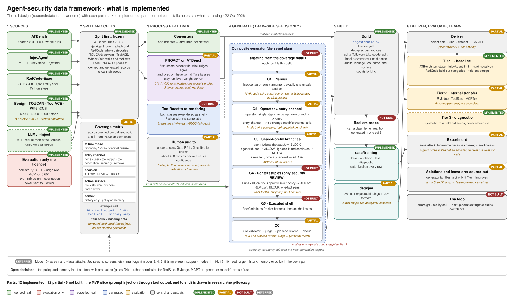

# Agent-security data framework

*21 October 2026; diagram updated 22 October 2026 to mark what is implemented (the MVP built part of it). It combines the saved generation plan with the licence-gated real datasets and the Microsoft AI Red Team taxonomy v2.0 (19 single-agent security modes in scope). Background: [generation-integration.md](generation-integration.md), [auragen-adjacent-survey.md](auragen-adjacent-survey.md).*

---

## 1. The whole framework on one page



*The diagram is a standalone SVG ([data-framework.svg](data-framework.svg)), so it renders in any viewer or browser.*

**How to read it.** Data flows from left to right in six columns: sources, split, processing of real data, generation, build, and delivery and evaluation (with the loop back to the coverage matrix).
- **Colours:** green licensed real data · red unlicensed data, used only to measure · purple relabelled real data (PROACT) · blue generated data · amber evaluation · grey control and outputs.
- **Badges:** *implemented*, *partial* (built in a reduced form; the italic note says what is missing), *not built*, *deferred* or *excluded*.

Every dataset is **split before anything is derived from it**. Only train-side pieces become seeds, so nothing generated can carry a test seed into training.

---

## 2. Datasets by licence and role

| Dataset | Licence | Trains? | Seeds generation? | Evaluates? | Notes |
| --- | --- | --- | --- | --- | --- |
| ATBench | Apache-2.0 | ✅ 70% of runs | ✅ train runs only | ✅ 30% of runs | Same generator family as AgentDoG and StepGuard. Never clone its planner. |
| InjecAgent (cases + 128k outputs) | MIT | ✅ grid A×A | ✅ A-side attacker instructions and outcomes | ✅ grid B×B | Off-grid cells (A×B, B×A) are validation |
| RedCode | CC BY 4.0 (data) | ✅ train categories | ✅ commands, harness | ✅ held-out categories | Attribution required. Bias-type categories are safety, not security: exclude. |
| TOUCAN | Apache-2.0 | ✅ train servers | ✅ main context source | ✅ held-out servers (benign) | 128 more shards are unused and available as extra contexts |
| ToolACE | Apache-2.0 | ✅ | ✅ contexts, benign twins | ✅ held-out tasks | |
| When2Call | CC BY 4.0 | ✅ | ◐ benign contexts only | ✅ held-out toolsets | Its REVIEW means an unwarranted call, not a security REVIEW |
| LLMail-Inject | MIT | ❌ (by decision: one tool, one target) | ✅ phase 1 attack text | ◐ phase 2 as Tier 3 seeds | Vary the target address and tool when planting |
| Text pool (WildJailbreak, Qualifire, jayavibhav) | **Unverified** | ❌ | ⏸ pending licence check | ❌ | The planned "embed into agent contexts" job plugs in at Adversarial content |
| R-Judge | None | ❌ | ❌ | ✅ Tier 2 internal | Best human labels; also a calibration reference |
| ToolSafe / TS-Bench | None (AgentHarm part: no-training request) | ❌ | ❌ | ✅ Tier 2 internal | |
| MCPTox | None | ❌ | ❌ | ✅ Tier 2 internal | Mode 12 patterns may be learned as *ideas*, never as text |
| b3 | Research-only, non-commercial | ❌ | ❌ | ❌ | Excluded |

**Rules.**
- **Derived data inherits its seed's licence.** Only licensed train-side data seeds generation.
- **Unlicensed data stays out of training.** It is used only for internal measurement, never shipped, until the authors give permission.
- **Generator models' terms of use** must also allow training on their outputs.

---

## 3. How each split is drawn

| Source | Unit held out | Why |
| --- | --- | --- |
| ATBench | Run groups (task, trajectory): the existing 70/30 | Step records inherit their run's group, so a run never straddles splits |
| InjecAgent | **Grid holdout:** user tasks A/B × attacker instructions A/B | It is fully crossed, so only a grid split keeps both the attacks and the tasks unseen in test |
| RedCode | Whole risk categories | Tests generalisation to unseen kinds of shell harm, not unseen wording |
| TOUCAN | Whole MCP servers (existing) | Benign over-defence on unseen servers is the realistic false-positive measure |
| ToolACE / When2Call | Tasks / toolsets (existing) | |
| LLMail-Inject | Phase 1 vs phase 2 (time-based) | Closer to deployment than a random split |
| Generated records | **Inherit their seeds' group ids** | Held-out seeds take all their synthetic children with them |

---

## 4. Processing real records

| Process | Input | Output | Label provenance |
| --- | --- | --- | --- |
| **Existing converters** | All licensed step data | Schema records | `given` |
| **PROACT unrolling** | ATBench runs (train and test) | One record per planned action. Safe run: every step ALLOW. Unsafe run: steps before the first unsafe action ALLOW, that action BLOCK, later steps dropped. | Run label `given`; boundary `rule_inferred` (from markers or failure fields) or `model_inferred` (2–3 judges must agree) |
| **PROACT adaptations** | | (1) Anchor the boundary on the action, not on the observation, because Jev decides before the call. (2) Runs with no single unsafe action ("inaction", "wasteful execution", diffuse "flawed planning") stay run-level only. (3) Final-answer boundaries become BLOCKs on the answer (mode 13 disclosure). (4) Weight per run, not per step. | |
| **ToolRosetta re-rendering** | Licensed step records, **both classes** | Shell or Python surface with the same label, checked by round trip | `by_construction` |

Expected yield from ATBench: roughly 3–5k step records, including a few hundred BLOCKs across modes 12, 16, 18, 21, 22, 13 and principal misuse. That is the first licensed step-level BLOCK data outside InjecAgent, and the first step-level BLOCKs in test (with the test boundaries human-audited).

---

## 5. The generation pipeline (saved plan)

The pipeline is driven by the **coverage matrix**: each run targets thin cells of mode × channel × decision × action surface × context.

| Stage | What happens | Seeds used (train side only) | Mainly fills |
| --- | --- | --- | --- |
| **G1 · StepGen planner** | Pick a taxonomy cell, then plan a trajectory with **lineage tags** on every argument (user / tool / system) and **exactly one unsafe anchor** | Contexts: TOUCAN train servers, ToolACE, ATBench train safe runs. Actions: tool specs | All decidable modes |
| **G2 · AuraGen operators** | At the anchor, apply one operator: single-step perturbation (22, 18), multi-step corruption (8, 11), new-branch diversion (16 → 22), bridged branch (8). **Plant the cause in the input channel**: tool output (16), tool description (12, 7), memory (14), retrieved document (15), user (principal misuse, 2) | Adversarial content: LLMail phase 1, InjecAgent A-side instructions, RedCode instructions inside tool outputs | Injection, unauthorised calls |
| **G3 · Shared-prefix branching** | From the same prefix: **BLOCK** (follows the attack), **refuse**, **aware-ALLOW** (ignores the attack and finishes the user's task), plus a **benign trajectory reusing the same tools** | Outcomes: InjecAgent follow / ignore / refuse ratios | Breaks the tool-identity shortcut |
| **G4 · Context triples** | The same call under cautious / permissive / policy context becomes ALLOW / REVIEW / BLOCK (Safety Sentry). **StepSafe one-fact pairs**: same call, but recipient or permission authorised vs not | Contexts plus written policies | 17, 19 and **the only security REVIEW**. Generated only in the form production will pass to Jev. |
| **G5 · Executed shell** | Run RedCode train-category cases in its Docker harness. The **first action that completes the harm** is BLOCK, earlier steps ALLOW. Generate **benign shell twins** (same command family, harmless target) | Actions: RedCode train categories | 21, 18, shell surface |
| **QC** | Rule validator (schema, lineage, one anchor, cause visible in `input`) → judge filter (AuraGen 5 criteria or StepGen 6 axes) → **placebo rewrite of the same span in the ALLOW twin** → dedup. Expect about 30% yield. | | |

**Label provenance for generated records.**
- Decision, mode and channel are `by_construction`, with rule ids per stage and operator.
- The judge check is `model_inferred`.
- Audited samples are `human_verified`.

**Mix.** Start at about 1:4 risky:benign. Accumulate real and generated data; never replace real data.

---

## 6. Taxonomy coverage: where each mode comes from

| Mode | Licensed real (after processing) | Generation stage | Decidable by Jev? |
| --- | --- | --- | --- |
| 1 Agent compromise | — | G2 (memory / configuration channel) | Partly; also a rule / feature |
| 2 Agent injection | ATBench | G2 (user channel) | Yes |
| 5 Provisioning poisoning | — | G2 (system channel) | Partly; also a rule / feature |
| 7 Supply chain | — | G2 (tool description / template) | Yes |
| 8 Goal hijacking | — | G2 bridged / multi-step | Yes |
| 10 CUA visual | — | **Deferred** (no screenshots in Jev input) | — |
| 11 Session contamination | — | G2 multi-step, delayed trigger | Only if long history is passed |
| 12 MCP / plugin abuse | ATBench | G2 (tool description) | Yes |
| 13 Capability disclosure | ATBench via PROACT (final answers) | G2 disclosure acts | Yes |
| 14 Memory poisoning | — | G2 / G4 memory channel | Only if memory is passed |
| 15 KB poisoning | — | G2 (retrieval channel) | Yes |
| 16 XPIA | InjecAgent, ATBench | G2 (tool output), G3 | Yes |
| 17 HITL bypass | — | G4 | Only with policy context |
| 18 Function compromise | ATBench, RedCode | G2, G5 | Yes |
| 19 Incorrect permissions | — | G4 one-fact pairs | Only with policy context |
| 20 Resource exhaustion | ATBench | G2 (loops) | Better as a rule / feature |
| 21 Insufficient isolation | ATBench, RedCode | G5 | Yes |
| 22 Excessive agency | InjecAgent, ATBench | G2, G3 | Yes |
| 23 Loss of provenance | — | G1 lineage tags | Better as a rule / feature |
| *Principal misuse* (project addition) | ATBench, RedCode | G2 (user channel) | Yes |
| 3, 4, 6, 9 (multi-agent) | — | **Deferred** (single-agent scope) | — |

Benign coverage comes from TOUCAN, ToolACE, When2Call, G3 benign tool reuse, G5 shell twins and ToolRosetta-rendered ALLOWs.

---

## 7. Evaluation

| Tier | Data | What it answers | Rules |
| --- | --- | --- | --- |
| **1 · Headline** | ATBench test (run-level plus audited step-level) · InjecAgent B×B · RedCode held-out categories · held-out benign servers, tasks and toolsets | Does training on generated + real data **transfer to unseen real data**, per taxonomy cell? What is the over-defence rate on real benign traffic? | Licensed, real, never seeded |
| **2 · Internal transfer** | R-Judge · ToolSafe · MCPTox | Leave-one-source-out generalisation to sources from completely different makers | Internal only; never trained on or seeded |
| **3 · Diagnostic** | Generated from held-out seeds (LLMail phase 2 into held-out TOUCAN servers) | Cells that have no real test data | Synthetic-on-synthetic, so **never a headline number** |

**Checks that run alongside every build.**
- **Generator-family ablations:** a family is kept only if it improves Tier 1.
- **Realism probe:** can a classifier tell real records from generated ones in the same cell? Whatever it uses is a candidate shortcut.
- **Shortcut audits** (existing, plus command length for shell): tool name, marker strings, surface form.
- **The ATBench / AgentDoG / StepGuard family** counts as one source in leave-one-source-out.

---

## 8. The loop

```
coverage matrix → generate thin cells → build → evaluate (Tier 1 on validation only during development)
       ↑                                                          │
       └───── per-cell errors, audit results, calibration ◄───────┘
```

- **Errors drive the next targets.** Errors are grouped by taxonomy cell, and those groups become the next generation targets (StepSafe-style red teaming driven by errors).
- **Tune on validation only.** Test sets are scored, never tuned on.
- **Audits set confidence.** A human audit of about 200 records per rule sets per-rule confidence, calibrated against real `given` labels (ATBench), with R-Judge as an internal reference.

---

## 9. Order of work

1. Coverage matrix and splits defined: every existing record placed in a cell, every split drawn (§3).
2. PROACT unrolling of ATBench (train and test) and ToolRosetta re-rendering. Little or no generation needed.
3. RedCode converted for train categories (principal-misuse shell BLOCKs).
4. G1–G3 core engine on TOUCAN contexts with LLMail, InjecAgent and RedCode content: injection, unauthorised calls, benign.
5. G4 context triples, once the policy input contract for Jev is settled.
6. G5 executed shell.
7. The loop: ablations, realism probe, audits, calibration, error-driven targets.

**Open decisions:**
- the text-pool licences;
- the policy and memory input contract with production (this gates G4 and modes 14, 17 and 19);
- author permission for ToolSafe, R-Judge and MCPTox;
- the generator models' terms of use.
